# Container Platform Lab: Docker and Kubernetes on a Multi-Node kind Cluster


-326CE5?logo=kubernetes&logoColor=white)


A homelab project that evaluates Docker and Kubernetes as a platform for running containerized applications. Working from a single Windows 11 workstation, I took containers through their full lifecycle, investigated and troubleshot them from the inside, hardened them with resource limits, non-root execution, and vulnerability scanning, and then moved the workload onto a three-node Kubernetes cluster to test declarative deployments, self-healing, scaling, and service networking.

The project is framed around a fictional company, **Acme Software Solutions**, which has started adopting containers and wants to know whether Kubernetes is worth standardizing on. The goal was to build a realistic proof of concept and come away with an evidence-based recommendation.

---

## Table of Contents

- [Highlights](#highlights)
- [Environment](#environment)
- [Repository Structure](#repository-structure)
- [Quick Start](#quick-start)
- [Docker Operations](#docker-operations)
  - [Container Lifecycle](#container-lifecycle)
  - [Investigating and Troubleshooting Containers](#investigating-and-troubleshooting-containers)
  - [Examining Processes Inside a Running Container](#examining-processes-inside-a-running-container)
  - [Security and Operational Hardening](#security-and-operational-hardening)
- [Kubernetes Operations](#kubernetes-operations)
  - [Deploying a Workload](#deploying-a-workload)
  - [Self-Healing](#self-healing)
  - [Scaling](#scaling)
  - [Reliable Access with a Service](#reliable-access-with-a-service)
- [Challenges and Troubleshooting](#challenges-and-troubleshooting)
- [What I Learned](#what-i-learned)
- [Recommendations for Production](#recommendations-for-production)

---

## Highlights

The cluster runs three real nodes, one control plane and two workers, so scheduling, failover, and workload distribution behave the way they would on a multi-node cluster rather than being simulated on a single node. Deleting a running Pod caused Kubernetes to detect the gap and bring up a replacement within seconds, with no manual intervention. Scaling from three replicas to five took a single command. A NodePort Service gave the application a stable name and IP that kept routing traffic correctly no matter which Pods came and went. On the Docker side, switching nginx to its Alpine variant cut the image's disk usage from 242 MB to 94.4 MB, and a Docker Scout scan of the demo application surfaced 29 CVEs, including 3 Critical, almost all of which were fixable with routine dependency upgrades.

---

## Environment

| Component | Choice |
|-----------|--------|
| Host | Windows 11 workstation |
| Container runtime | Docker Desktop with the WSL2 backend |
| Kubernetes | Docker Desktop's built-in Kubernetes, **kind** cluster type |
| Nodes | `desktop-control-plane`, `desktop-worker`, `desktop-worker2` |
| Security scanning | Docker Scout |

Everything runs directly on the host through WSL2, with no virtual machine layer in between, which gives Docker and Kubernetes near-native Linux performance and keeps networking simple. I chose the kind cluster type over Docker Desktop's simpler single-node kubeadm option specifically so I could demonstrate genuine multi-node behavior. Each kind node runs as its own Docker container, so the cluster behaves like a real multi-node environment for scheduling, scaling, and self-healing even though it all lives on one physical machine.

I validated the environment by confirming that Docker Desktop's Kubernetes indicator showed **Running** and that all three nodes reported **Ready** in the Nodes panel. Docker itself was verified by running a test container and loading it in the browser.

| Docker Installed | First Container | Cluster Status | Cluster Nodes |
|:---:|:---:|:---:|:---:|
| 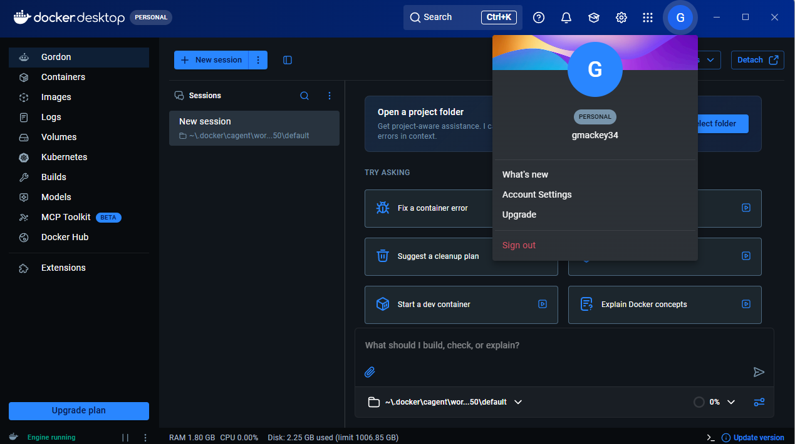 | 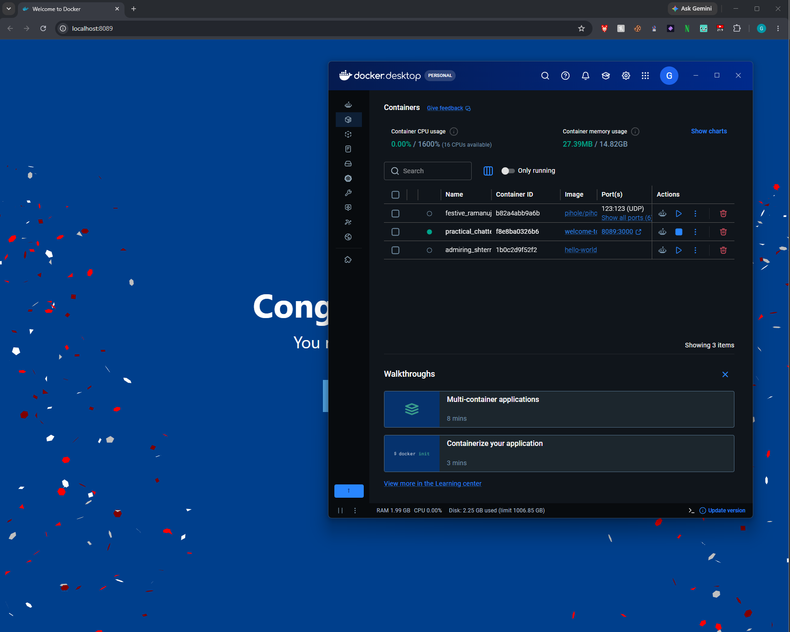 |  | 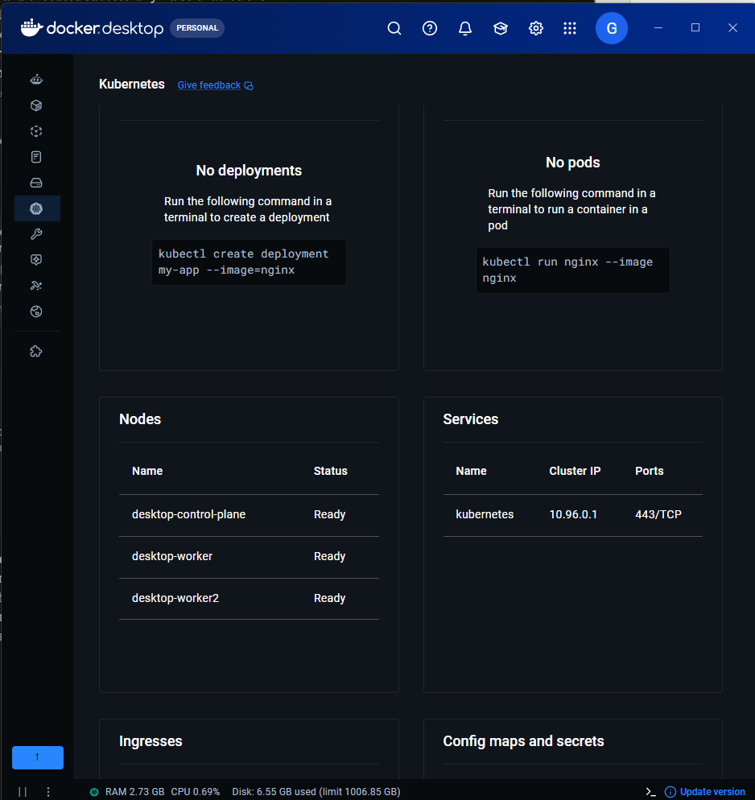 |

---

## Repository Structure

```
acme-container-platform/
├── k8s/
│   ├── deployment.yaml     # nginx Deployment, 3 replicas
│   └── service.yaml        # NodePort Service in front of the Deployment
├── docs/
│   └── images/             # Screenshots used in this README
└── README.md
```

---

## Quick Start

With Docker Desktop running and its Kubernetes cluster enabled (kind, three nodes):

```powershell
# Deploy the workload and expose it
kubectl apply -f k8s/deployment.yaml
kubectl apply -f k8s/service.yaml

# Check on it
kubectl get pods -o wide
kubectl get services

# Reach the app from the host (see "Challenges" for why port-forward is needed)
kubectl port-forward svc/my-app 8090:80
# then browse to http://localhost:8090
```

The manifests were originally generated imperatively and then saved as YAML so they could be applied declaratively:

```powershell
kubectl create deployment my-app --image=nginx --replicas=3 --dry-run=client -o yaml > deployment.yaml
kubectl expose deployment my-app --port=80 --target-port=80 --type=NodePort --dry-run=client -o yaml > service.yaml
```

---

## Docker Operations

### Container Lifecycle

I took a single container through its complete lifecycle: started it from an image, stopped it, restarted it, and finally removed it. Stopping a container halts its main process and moves it to **Exited**, but the container object still exists with its configuration, filesystem changes, and metadata intact, so it can be started again exactly where it left off. Removing it deletes the container object entirely, along with anything in its writable layer that was not stored in a volume; running the application again means creating a fresh container from the image.

That distinction matters operationally. Stopping is the right call for maintenance windows, saving resources during quiet periods, or preserving a container's exact filesystem for investigation, and restarting a stopped container is faster than recreating one. Removing is for containers that are truly finished, such as decommissioned applications or temporary test containers.

| Running | Stopped | Restarted | Removed |
|:---:|:---:|:---:|:---:|
| 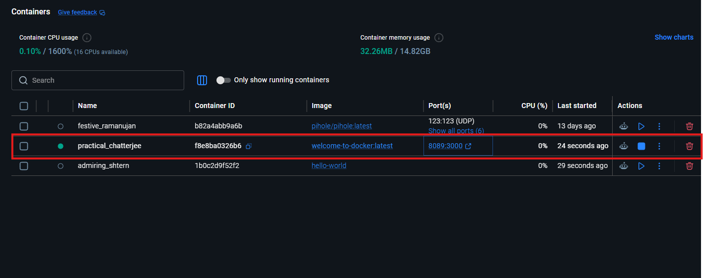 | 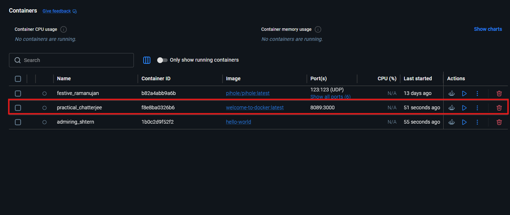 | 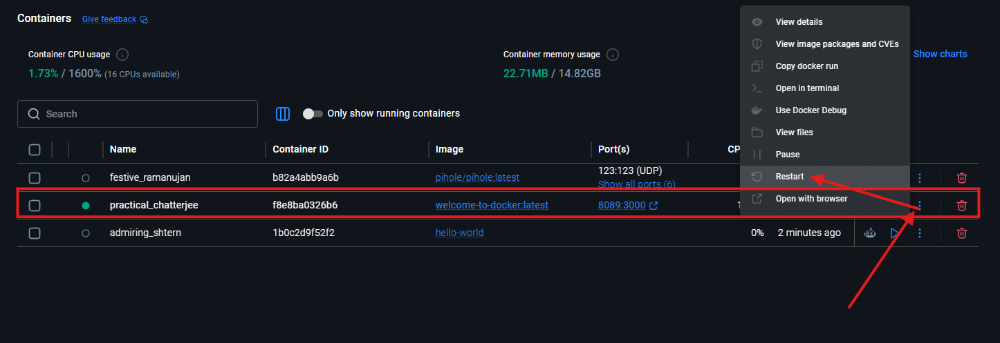 | 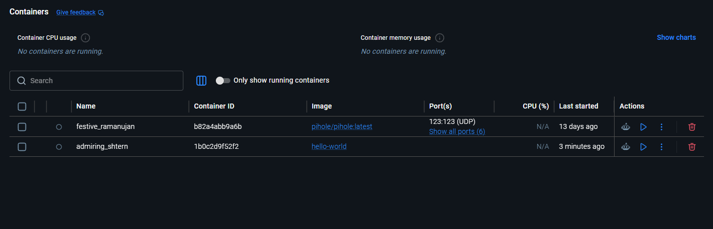 |

### Investigating and Troubleshooting Containers

To build a full picture of a running container, I collected its metadata with `docker inspect`, reviewed its application logs with `docker logs`, filtered the log output to isolate specific events such as error responses, and gathered additional runtime details including running processes and environment variables.

Metadata and logs answer two different questions. Metadata answers *how is this container configured*: its ID, source image, creation time, network settings, and mounts, which makes it easy to confirm a container matches its intended specification or spot a misconfiguration such as the wrong image tag. Logs answer *what actually happened while it was running*: crashes, failed requests like 404s and 500s, unexpected restarts, permission failures, and slow responses. Used together, a misconfiguration found in the metadata often explains an error pattern found in the logs, or the other way around.

| Metadata | Logs | Filtered Logs | Runtime Details |
|:---:|:---:|:---:|:---:|
| 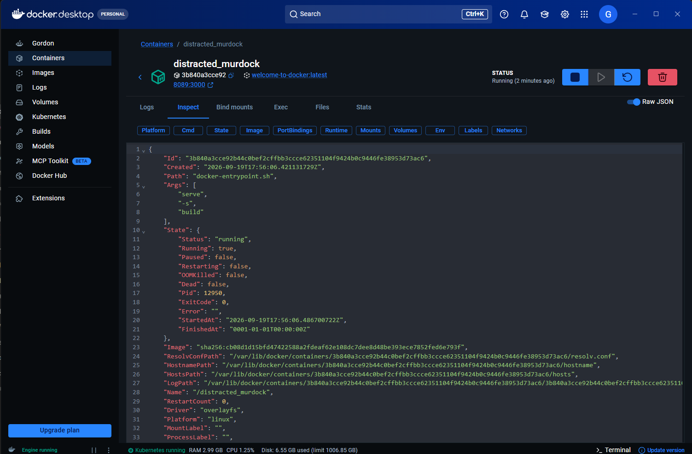 | 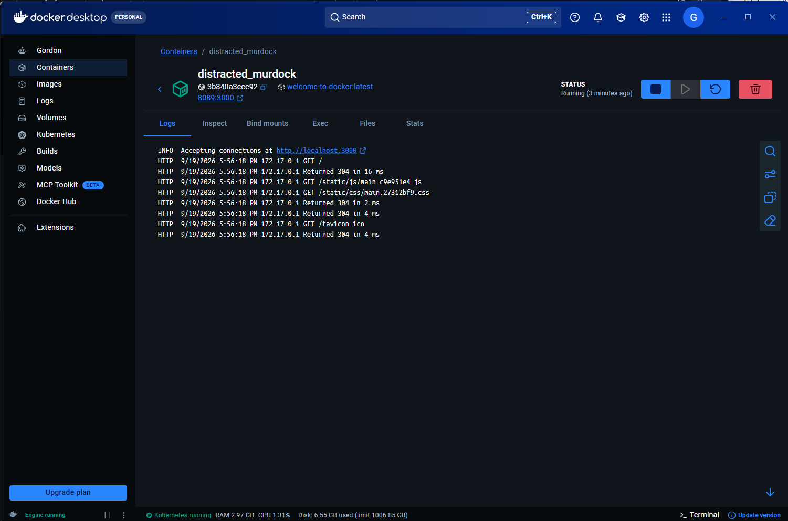 | 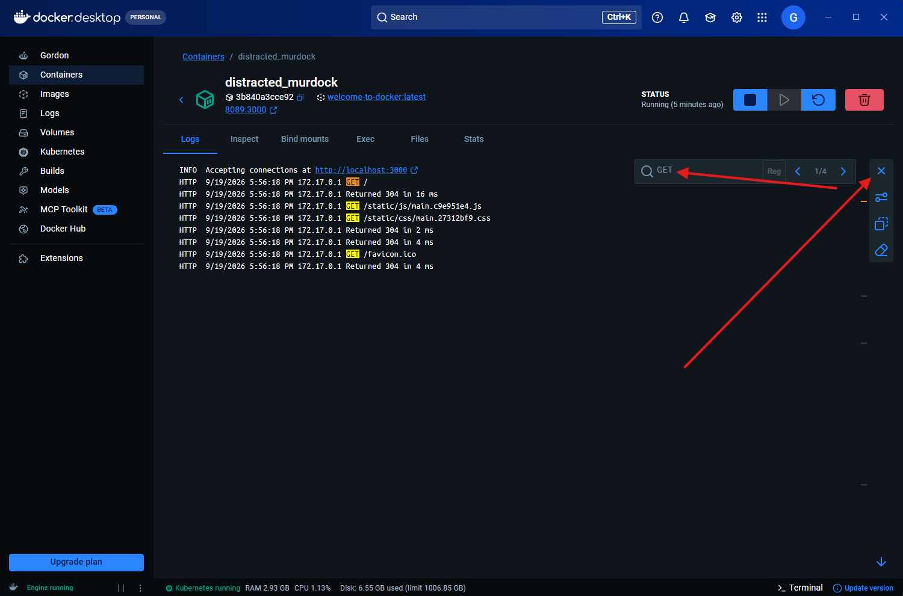 | 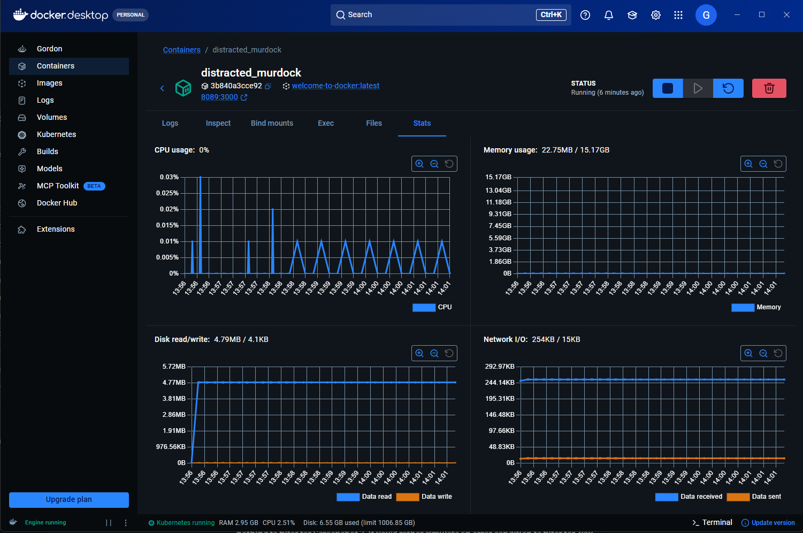 |

In a real production incident I would want more than a single container's view: live CPU, memory, and network metrics to rule out resource exhaustion, centralized logs aggregated across every replica, a record of recent deployments and configuration changes, health and readiness probe results, and monitoring dashboards to establish a timeline.

### Examining Processes Inside a Running Container

I opened an interactive shell inside the running container with `docker exec -it secure-demo /bin/sh`, then used `ps aux` to list its processes, `env` to view its environment variables, and `hostname` to confirm its isolated hostname. I also ran a one-off command from the host without staying inside, using `docker exec secure-demo cat /etc/hostname`.

The Node.js application process appeared as **PID 1**, the entry point Docker launched when the container started. PID 1 is special because the container's lifecycle is tied directly to it: when it exits, the container stops, regardless of what else is running, and Docker uses its exit code to determine the container's final status. It also takes on init-like responsibilities such as handling termination signals and reaping child processes.

`docker exec` starts a *new*, separate process alongside PID 1, so I could inspect files, run diagnostics, and test connectivity from the application's exact runtime environment without interrupting it. That is safer than `docker attach`, which ties your terminal directly to the main process, so any input goes to the application itself and interrupting the session can risk stopping it.

| Shell Access | Processes | Runtime Environment | One-off Command |
|:---:|:---:|:---:|:---:|
| 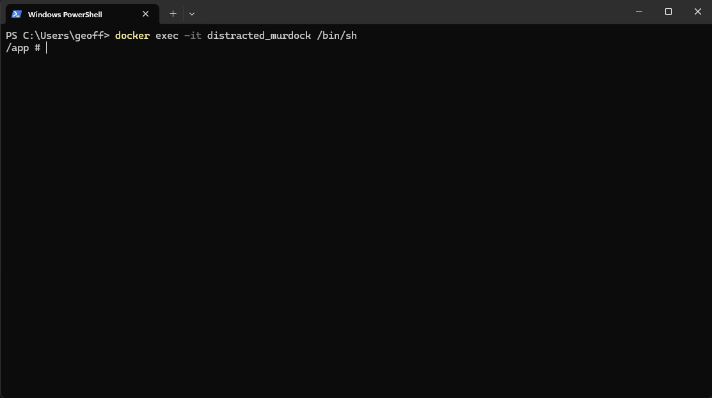 | 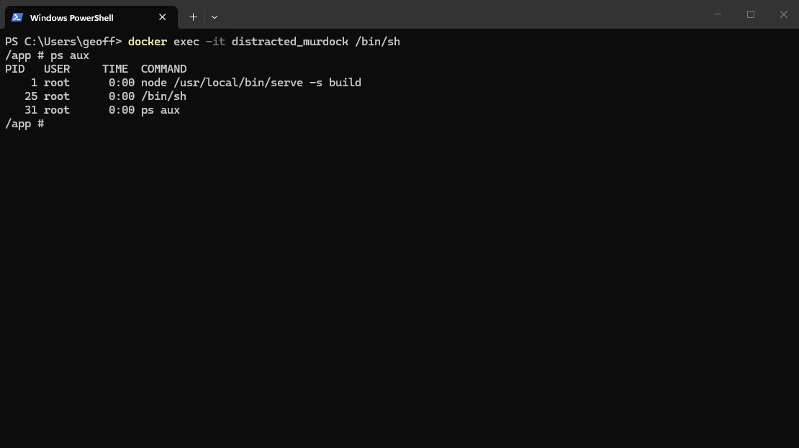 | 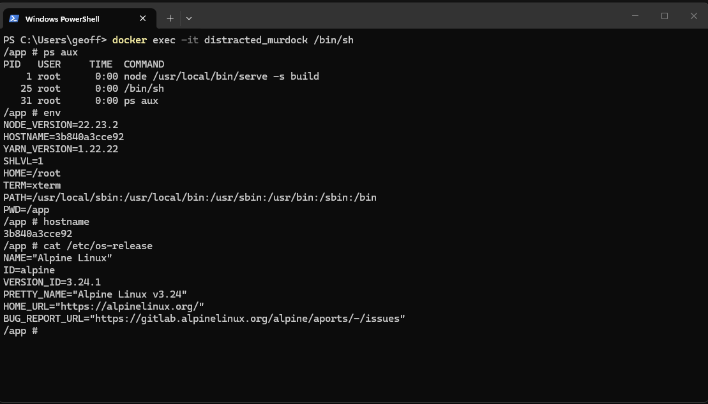 | 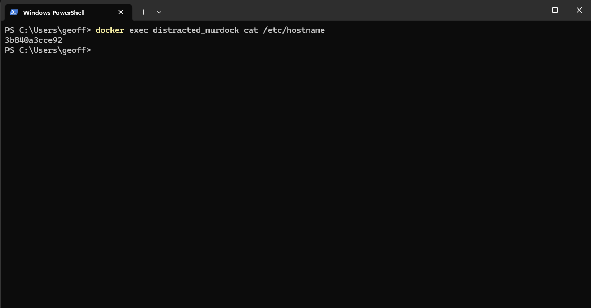 |

### Security and Operational Hardening

**Build optimization.** Comparing `nginx:latest` (Debian-based) against `nginx:alpine` showed disk usage dropping from 242 MB to 94.4 MB, and content size from 66.3 MB to 27.2 MB, just from choosing a smaller base image. Smaller images pull faster, start faster, consume less storage and bandwidth, and ship fewer packages, which means fewer components that could carry vulnerabilities.

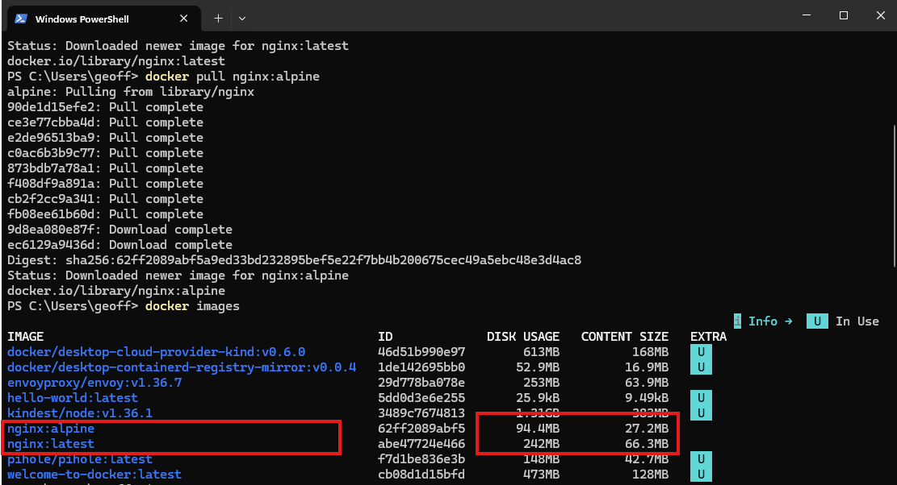

**Resource limits.** I ran a container with explicit ceilings and confirmed them with `docker inspect` and `docker stats`:

```powershell
docker run -d --name resource-demo --memory=256m --cpus=0.5 -p 8089:80 welcome-to-docker
```

Limits prevent a single container from monopolizing a shared host's CPU or memory and starving its neighbors, contain runaway processes and memory leaks before they take down the host, and make capacity planning predictable.

**Non-root execution.** Running with `--user 1000:1000` forced the container's process to run as the image's built-in, low-privilege `node` account instead of root, which I confirmed with `docker exec secure-demo whoami`. If the application were ever compromised, an attacker would inherit only those minimal permissions rather than root inside the container, making privilege escalation and container escape significantly harder.

| Resource Limits | Non-root User |
|:---:|:---:|
| 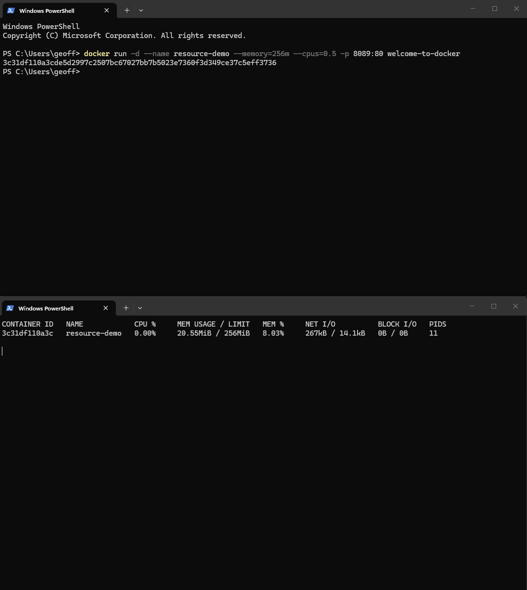 | 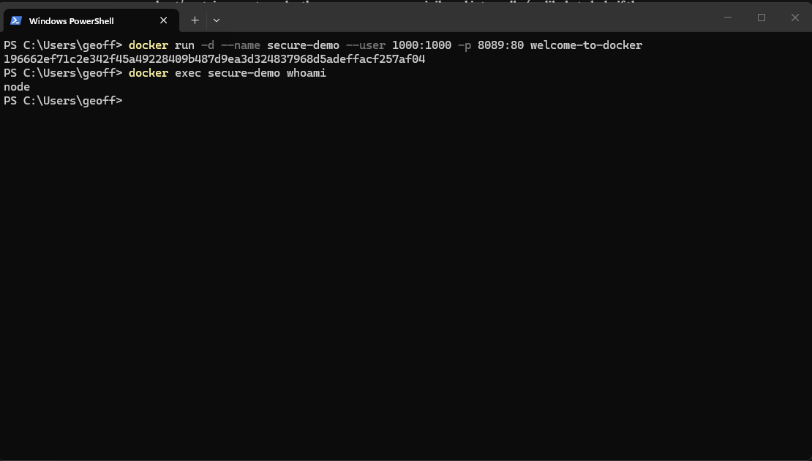 |

**Vulnerability assessment.** A Docker Scout scan of `welcome-to-docker:latest` found **29 vulnerabilities across 10 packages**.

| Severity | Count |
|----------|------:|
| Critical | 3 |
| High | 17 |
| Medium | 8 |
| Low | 1 |

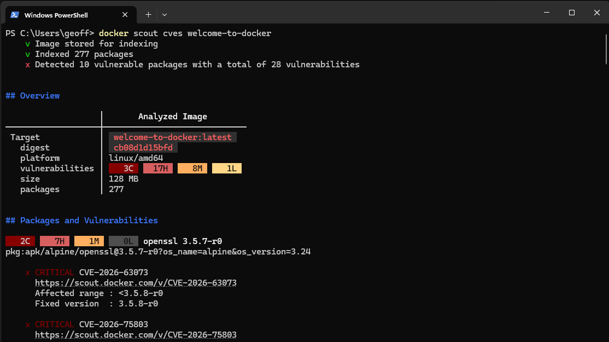

The biggest single source was `openssl 3.5.7-r0`, which accounted for 2 Critical and 7 High CVEs, all fixed in `3.5.8-r0`. The Node.js dependency `tar 7.5.11` contributed 1 Critical and 2 High findings, including a Critical resource-exhaustion vulnerability (CVE-2026-59873) with a CVSS score of 9.2, fixed in `7.5.19`. The remaining High findings were spread across npm packages such as `brace-expansion`, `ip-address`, `picomatch`, `pacote`, and `sigstore`, mostly involving uncontrolled resource consumption, inefficient regular expressions, or improper signature verification. The single Low finding was in `postcss-selector-parser`.

If this were a production image, the three Critical findings, the `tar` CVE and the two OpenSSL CVEs (CVE-2026-63073 and CVE-2026-75803), would be fixed first, given their severity and OpenSSL's role as a foundational cryptographic library. The 17 High findings would follow closely, since several could be leveraged for denial of service. Encouragingly, fixed versions already exist for all three Critical findings and most of the High ones, so remediation is a dependency upgrade and image rebuild rather than a code change.

---

## Kubernetes Operations

### Deploying a Workload

I defined an nginx Deployment with three replicas in [`k8s/deployment.yaml`](k8s/deployment.yaml) and applied it with `kubectl apply -f`. Kubernetes created three Pods and scheduled them across the cluster's nodes, and `kubectl get pods` and `kubectl describe deployment` confirmed all three were Running with the Deployment fully ready and available. The describe output also showed the Deployment's labels, selector, image, and a chronological log of scheduling events.

This is a fundamentally different model from Docker. With `docker run`, I start and manage each container individually and nothing reconciles it if it disappears. With Kubernetes, I declare a desired state and the control plane takes responsibility for creating Pods, scheduling them across nodes, and continuously making sure reality matches the declaration. A Pod, the smallest deployable unit, wraps one or more containers that share a network namespace, gets its own cluster IP, and is managed as part of that self-healing system rather than in isolation.

| Manifest | Applied | Running | Described |
|:---:|:---:|:---:|:---:|
| 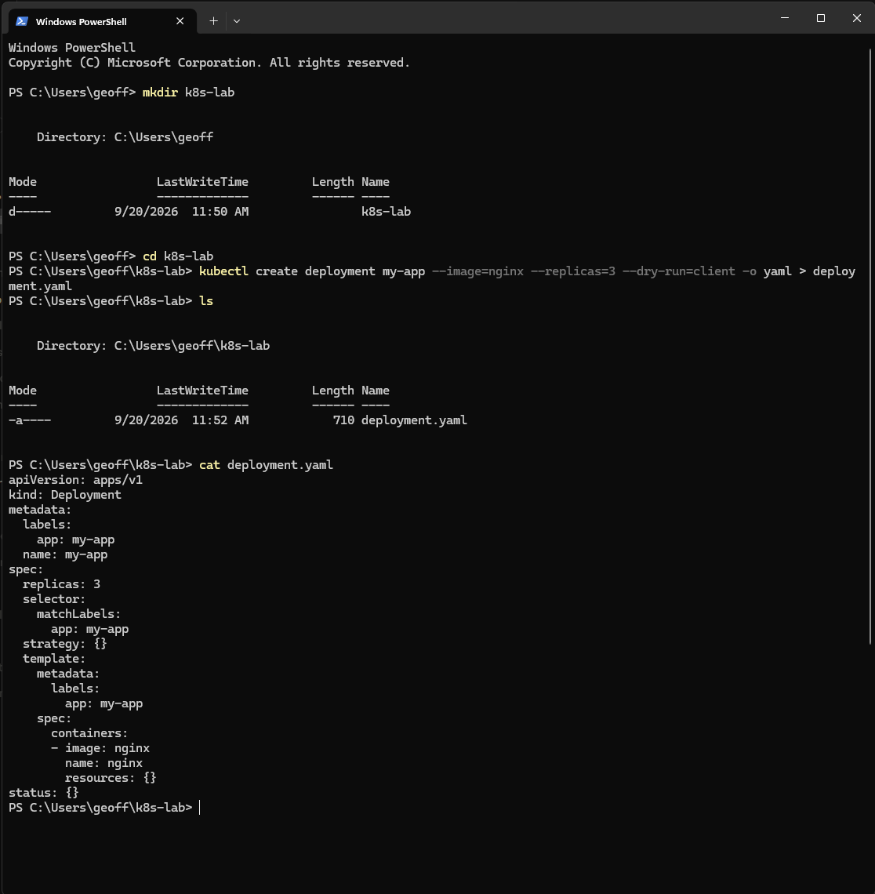 | 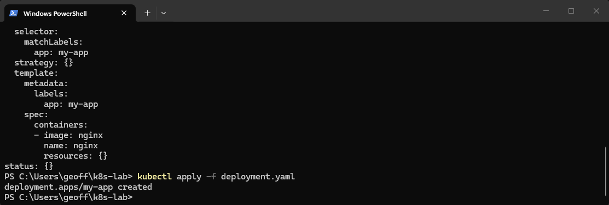 | 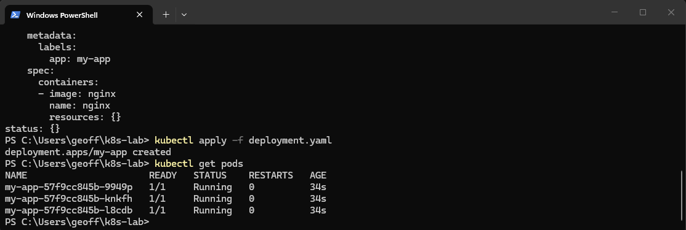 | 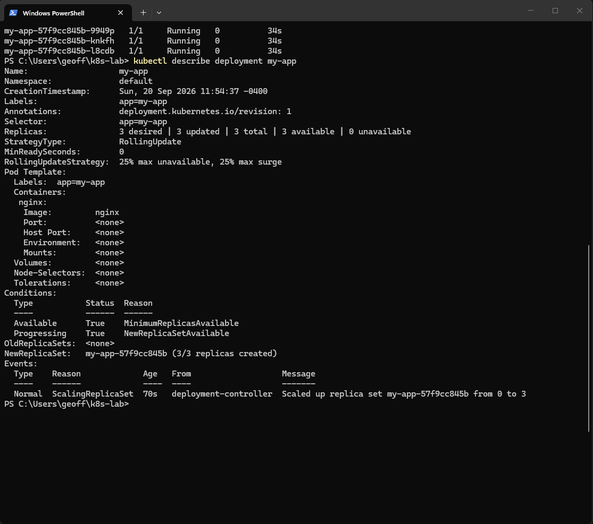 |

### Self-Healing

To simulate an unexpected crash, I force-deleted one of the three running Pods with `kubectl delete pod`. Running `kubectl get pods` immediately afterward showed Kubernetes already creating a replacement, recognizable by the same Deployment name and ReplicaSet hash but a new random suffix. Within moments it reached Running and the Deployment was back to full availability, with no action on my part.

This works because Kubernetes treats the applied manifest as the desired state and constantly compares it against the observed state of the cluster. When a Pod disappears, the Deployment's ReplicaSet controller sees fewer Pods than declared and creates one to close the gap. In production, where hardware faults, bugs, and resource exhaustion are inevitable, that means failures are corrected in seconds instead of waiting for a human to notice.

| Three Replicas | Pod Deleted | Replacement Created | Availability Restored |
|:---:|:---:|:---:|:---:|
| 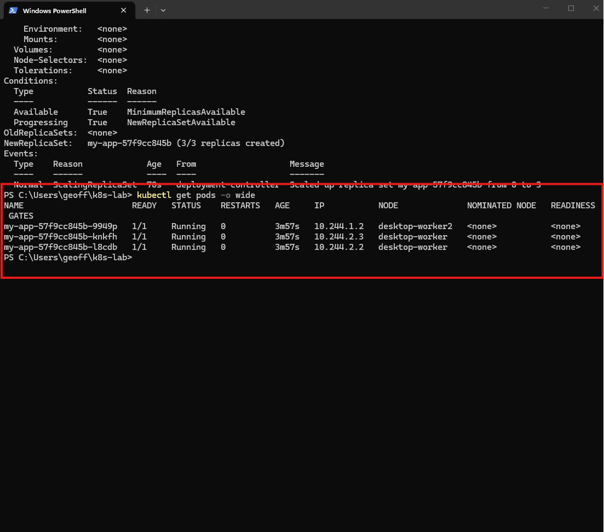 | 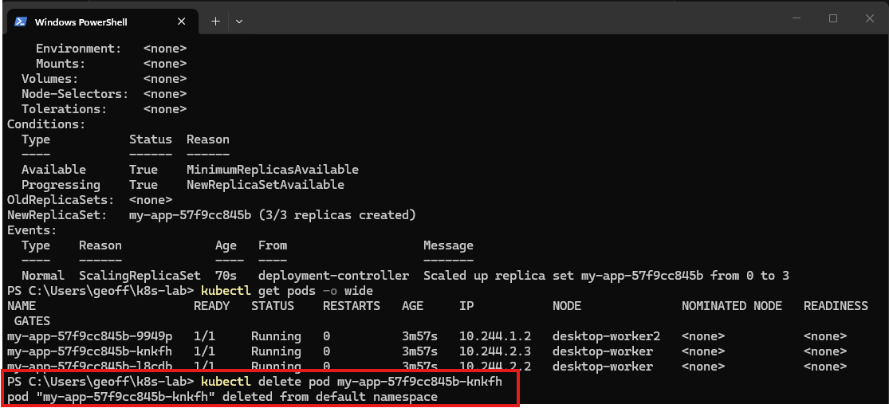 | 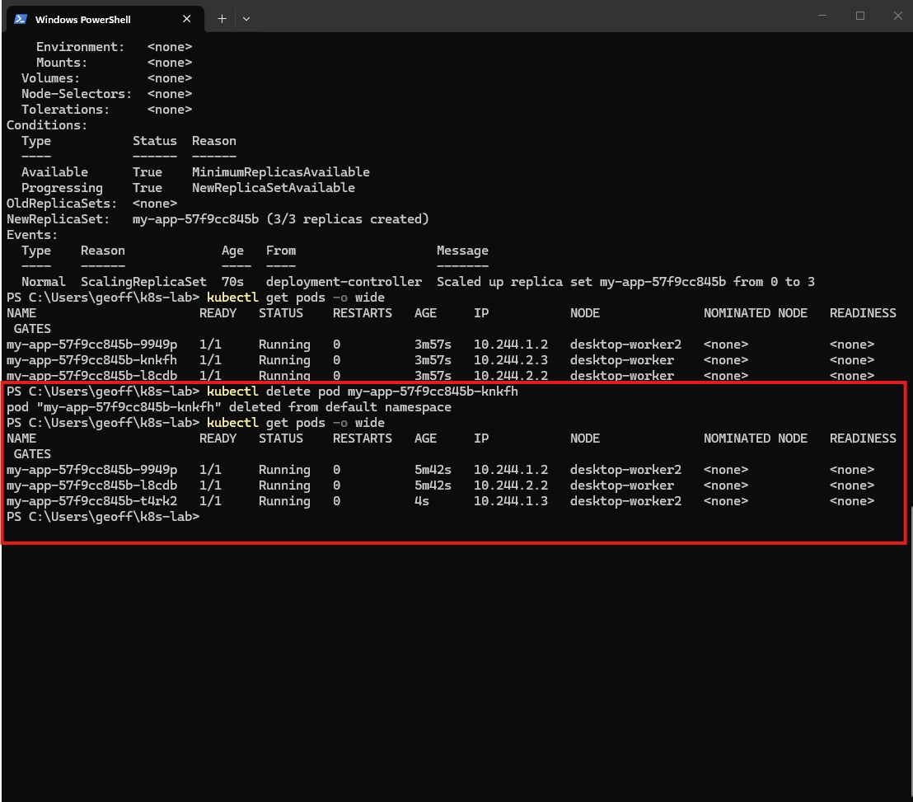 | 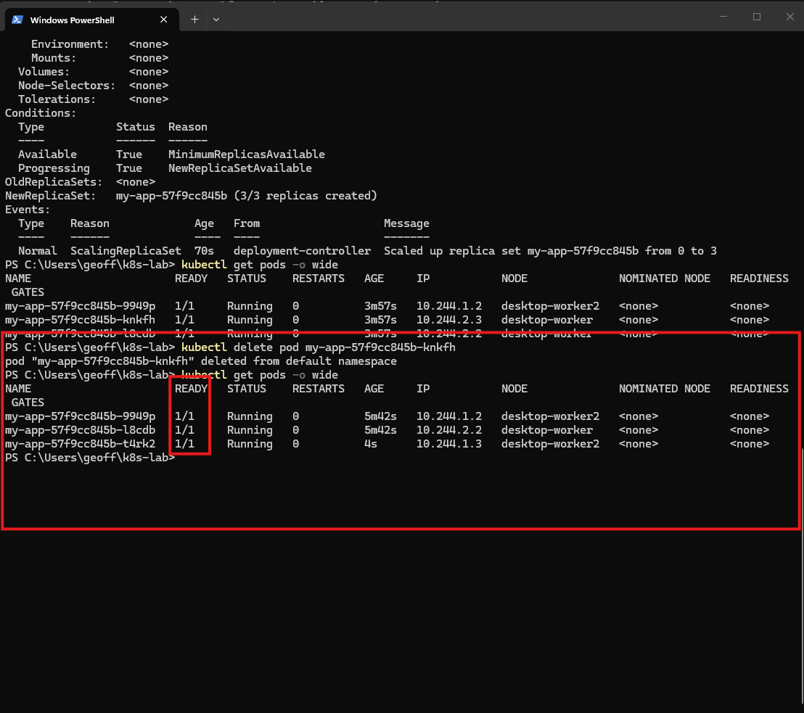 |

### Scaling

After confirming the Deployment's current state, I scaled it from three replicas to five:

```powershell
kubectl scale deployment my-app --replicas=5
```

The Deployment controller saw that the actual Pod count no longer matched the new desired count and created two more Pods, which were scheduled across the available nodes and reached Running shortly after. Scaling and self-healing rely on the same reconciliation loop and the same ReplicaSet mechanism, so whether Pods are being added, removed, or replaced after a crash, the cluster always converges on the single source of truth in the Deployment spec. Beyond scaling, Deployments also provide rolling updates and a revision history for rollbacks.

| Deployment Status | Before (3 replicas) | After (5 replicas) |
|:---:|:---:|:---:|
| 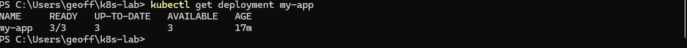 | 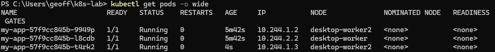 | 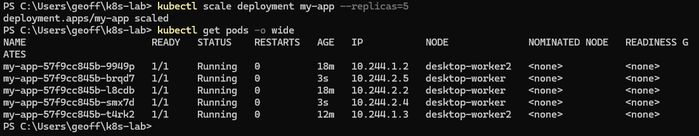 |

### Reliable Access with a Service

Pods are ephemeral: every replacement or new replica gets a new, unpredictable IP, so a client hard-coded to a Pod IP breaks the moment Kubernetes replaces that Pod. A Service solves this by giving the group of Pods a single stable cluster IP and DNS name, and routing traffic to whichever healthy Pods currently match its label selector. When a Pod is replaced, the Service's endpoint list updates automatically and clients never notice.

I exposed the Deployment with a NodePort Service defined in [`k8s/service.yaml`](k8s/service.yaml). `kubectl get services` showed it with a stable cluster IP and NodePort `31902`. To test service discovery from inside the cluster, I launched a temporary `busybox` Pod and used `wget` to reach the Service purely by its name, `my-app`, confirming that cluster DNS resolved it and routed the request to one of the backing Pods. For access from the host, I used `kubectl port-forward svc/my-app 8090:80` and loaded the application at `http://localhost:8090`.

| Service Manifest | Service Status | In-Cluster DNS Test | Browser Access |
|:---:|:---:|:---:|:---:|
| 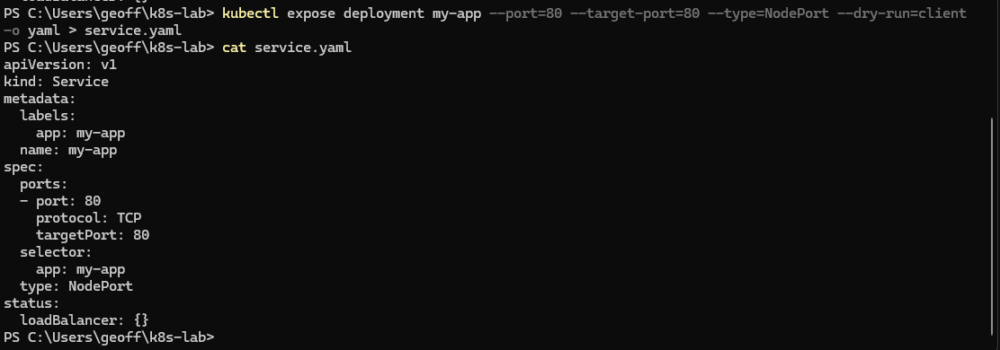 | 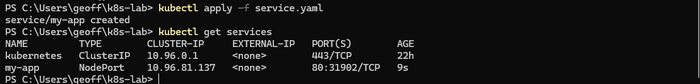 | 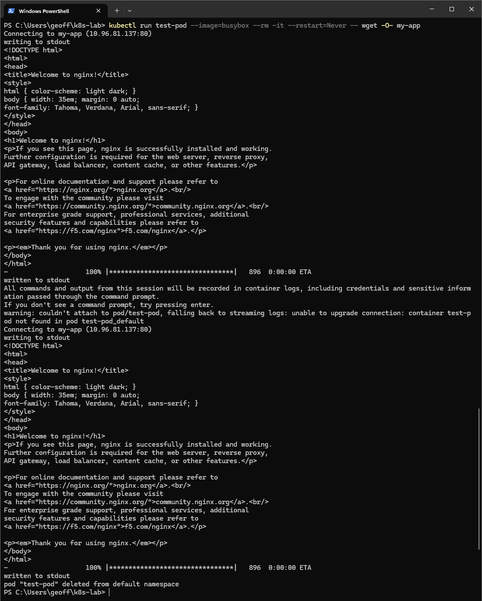 | 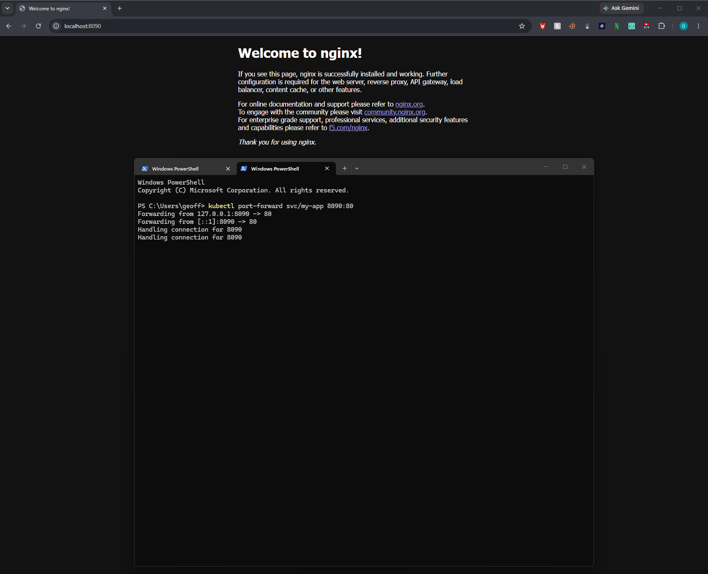 |

---

## Challenges and Troubleshooting

The main snag was external access to the NodePort Service. Although the Service was correctly configured and exposed on port `31902`, browsing to `http://localhost:31902` did not work. The cause is how kind-based clusters work: each node is itself a Docker container, isolated from the host network by default, so a NodePort opened on a node is not automatically reachable from the Windows host. Using `kubectl port-forward` to tunnel traffic from the host to the Service confirmed the Service was routing correctly and was a clean workaround for local testing. A production cluster with a proper load balancer or ingress controller would not need it, but it was a useful reminder that local environments can behave differently from production in ways that are easy to miss.

---

## What I Learned

The biggest takeaway was how different Kubernetes' operating model is from managing containers directly. Docker gives precise, hands-on control over individual containers, along with excellent diagnostic tools in metadata, logs, and `exec`. Kubernetes adds a declarative layer on top, where I describe what I want and the cluster continuously works to make it true. Self-healing, scaling, and service discovery all fell out of that one idea of reconciling desired state against actual state.

The NodePort issue taught me to validate networking assumptions early when moving from a local proof of concept toward a real deployment target, because local tooling like kind can hide or introduce networking behavior that will not match production. The Docker Scout scan was also eye-opening: even a simple demo application carried 29 known vulnerabilities, which made a strong case that image scanning belongs in every build pipeline rather than being an occasional manual check.

---

## Recommendations for Production

Based on this proof of concept, I would recommend adopting Kubernetes for container orchestration, given its demonstrated ability to keep applications available through self-healing and to scale on demand with minimal effort. A few things should be in place first.

| Area | Recommendation |
|------|----------------|
| Image security | Establish automated image scanning and a patching process in the build pipeline, given the volume and severity of findings in even a simple image |
| Image builds | Standardize on minimal base images such as Alpine or distroless |
| Runtime defaults | Require resource limits and non-root execution for every workload |
| Cluster | Run production on a managed or dedicated multi-node cluster rather than a local, development-oriented kind cluster |
| Networking | Use a load balancer or ingress controller for external access, and validate networking behavior on the real target platform early |
| Observability | Add centralized logging and metrics across all replicas to support incident response |

---

## Author

**Geoffrey Mackey**, Cybersecurity Professional & Student at the University of Cincinnati.
